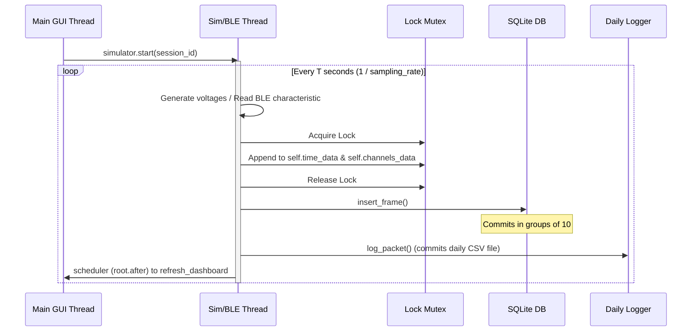

# BARC Telemetry Dashboard — System Specification, User Manual, and Architectural Documentation

This document serves as the official, comprehensive technical blueprint and user manual for the **BARC Telemetry Dashboard**. It details the system architecture, mathematical signal analysis logic, database schemas, concurrency models, operational protocols, and onboarding instructions.

---

## Document Control
* **Document Ref**: BARC-TD-SYS-SPEC-v2.0
* **Target Audience**: Evaluation Panel, Project Advisors
* **Classification**: Technical Design Specification & Operator Manual
* **Language/Standard**: GFM Markdown, Python 3.12+ compliant

---

## Table of Contents
1. [System Overview & Executive Summary](#1-system-overview--executive-summary)
2. [Hardware Integration & ADC Quantization](#2-hardware-integration--adc-quantization)
3. [Aesthetics & User Interface Specification](#3-aesthetics--user-interface-specification)
4. [User Manual (Non-Technical Operator Guide)](#4-user-manual-non-technical-operator-guide)
5. [Software Architecture & Component Details](#5-software-architecture--component-details)
6. [Data Pipeline & Concurrency Model](#6-data-pipeline--concurrency-model)
7. [Storage Subsystem Design (SQLite & CSV)](#7-storage-subsystem-design-sqlite--csv)
8. [Digital Signal Processing (DSP) & Analytics Formulation](#8-digital-signal-processing-dsp--analytics-formulation)
9. [Configuration Schema (JSON)](#9-configuration-schema-json)
10. [Hardware Integration Guide (Bleak Bluetooth LE)](#10-hardware-integration-guide-bleak-bluetooth-le)
11. [Verification & Testing Checklists](#11-verification--testing-checklists)
12. [Failure Modes, Diagnostics, and Troubleshooting](#12-failure-modes-diagnostics-and-troubleshooting)

---

## 1. System Overview & Executive Summary

The **BARC Telemetry Dashboard** is a high-performance desktop application built to acquire, visualize, analyze, and persist multi-channel sensor readings. It was developed to monitor analogue sensor systems (such as silicon photodiodes or transducers) that operate in range of $0.0\text{V}$ to $3.3\text{V}$. 

The dashboard resolves the critical problem of displaying high-frequency signal waveforms while calculating real-time mathematical diagnostics (such as pulse rise times, frequency, and inter-channel synchronization jitter) and logging data to disk without UI stuttering.

### Core Technology Stack Selection Rationale
* **GUI Engine**: `CustomTkinter`. Chosen to provide a dark-themed user interface without the heavy installation footprint, licensing complexities, or steep learning curves of Qt (`PyQt`/`PySide`).
* **Visualisation Engine**: `Matplotlib`. Reused the native Tkinter backend wrapper (`FigureCanvasTkAgg`) to implement clean plotting lines and allow direct integration of standard pan/zoom navigation toolbars.
* **Storage Engine**: `SQLite`. Zero-configuration, local file-based database (`telemetry_archive.db`) that operates without running an external server process.
* **Concurrency model**: Standard Python `threading` running a daemon queue, ensuring the serial interface or simulator continues to capture packets when the main thread draws.

---

## 2. Hardware Integration & ADC Quantization

The dashboard is designed to interface with custom signal conditioning boards transmitting data from a microcontroller's Analog-to-Digital Converter (ADC). The hardware target specifications match the high-performance specifications of the **Arduino Giga R1**:

### ADC Parameters
* **Resolution**: $16\text{-bit}$ resolution ($2^{16} = 65,536$ quantization levels).
* **Reference Voltage ($V_{ref}$)**: $3.3\text{V}$ reference.
* **Discrete Scale**: Raw values span from $0$ (representing $0.0\text{V}$) to $65535$ (representing $3.3\text{V}$).

### Quantization Equations

To convert the raw integer steps received over the telemetry link into physical voltages:
$$V_{voltage} = \left( \frac{\text{raw\_counts}}{2^{16} - 1} \right) \times V_{ref} = \left( \frac{\text{raw\_counts}}{65535} \right) \times 3.3$$

Conversely, when generating simulated signal data to mimic the photodiode voltages:
$$\text{raw\_counts} = \text{round} \left( \frac{\text{clamp}(V_{voltage}, 0.0, 3.3)}{3.3} \times 65535 \right)$$

---

## 3. Aesthetics & User Interface Specification

The interface is styled around a high-contrast dark theme designed to reduce eye strain during long-term laboratory testing:
* **Background Colors**: Deep Dark `#121214` (Main panel) and Charcoal `#1A1A1E` (Cards, Sidebars, Pop-ups).
* **Grid Borders**: Soft Slate `#25252A` (1px thick borders).
* **Typography**: Primary font family: `Segoe UI` (System default fallback). Console logs rendered in monospaced `Consolas` (`13pt`).
* **Visual Colors**: 
  * Channel 1: Neon Blue (`#3A7DFF`)
  * Channel 2: Emerald Green (`#2EA44F`)
  * Channel 3: Amber Gold (`#E1B12C`)
  * Channel 4 (Reserved): Peach Red (`#FFCCC4`)
* **Scale Scaling**: High-DPI screen configurations automatically trigger `ctk.set_widget_scaling(2.4)` on Linux/X11 to prevent tiny text and window layout distortion.

---

## 4. User Manual (Non-Technical Operator Guide)

### Installation Guide
1. **Install Python**: Ensure Python 3.12+ (64-bit) is installed.
2. **Install Libraries**: Run the pip installer command:
   ```bash
   pip install customtkinter matplotlib bleak
   ```
3. **Launch**: run `python main.py` in your terminal.

### Interactive Controls Reference

```
+-------------------------------------------------------+
|  [Sidebar Controls]       | [Live Multi-Channel Graph] |
|  - Start / Pause / Stop   |  - Pan & Zoom Toolbar      |
|  - Channel Selectors      |  - Normalization Switch    |
|  - Playback Dropdown      |                            |
|---------------------------+----------------------------|
|  [Diagnostics Monitor]    |  [Log Terminal Terminal]   |
+-------------------------------------------------------+
```

* **Start Simulation**: Spawns the telemetry worker. The status indicator displays a green `RUNNING` light. Waveforms scroll across the graph area in real-time.
* **Pause / Resume**: Temporarily freezes the telemetry loop. Timing counters are preserved. The graph is frozen, and status lights show a yellow `PAUSED` flag.
* **Stop**: Saves the current recording, flushes all telemetry to disk, and populates the sidebar dropdown list with the new session tag. The status displays a red `STREAM STOPPED` flag.
* **Clear Buffers**: Empties active graph and memory variables. *Note: Stored runs inside the SQLite database are NOT affected.*
* **Channel Visibility Toggle**: Checkboxes instantly hide or show specific sensor lines. The Y-axis automatically resizes to adapt to the remaining visible channels.
* **Normalize Switch**: When activated, scales all wave amplitudes between `0.0` and `1.0`. Useful for comparing the timing shapes of high-voltage and low-voltage channels simultaneously.
* **Replay Dropdown**: Select a past session. The application instantly loads it from SQLite and redraws it on the canvas for inspection.
* **Manage Sessions**: Opens a console to search, rename (assign custom tag names), or permanently delete recorded database sessions.

---

## 5. Software Architecture & Component Details

The codebase strictly decouples backend calculations (`core/`) from visual controls (`gui/`). This MVC (Model-View-Controller) structure ensures high flexibility.

```
barc_dashboard/
├── main.py                     # Entry point & clean shutdown orchestrator
├── config.py                   # Centralized configuration variables & settings loader
├── config_settings.json        # Saved user preferences (DB directory, line widths, etc.)
├── core/
│   ├── database/
│   │   └── manager.py          # Persistent SQLite connection & write batching
│   ├── telemetry/
│   │   ├── simulator.py        # Background telemetry simulation daemon
│   │   ├── ble_reader.py       # Asynchronous Bluetooth LE device scanner/reader
│   │   ├── csv_logger.py       # Auto-rotating daily CSV logger
│   │   └── adc.py              # ADC quantization scaling logic
│   └── analysis/
│       └── signal.py           # Pure mathematical DSP calculation routines
└── gui/
    ├── app.py                  # Main App Controller coordinating components
    ├── components/
    │   ├── sidebar.py          # Left-aligned control panel frame
    │   ├── chart.py            # Reusable styled Matplotlib canvas wrapper
    │   └── notification.py     # Slide-down UI alerts
    ├── dashboard/
    │   ├── page.py             # Main page frame (Grid definition)
    │   └── graph_renderer.py   # Plot updater and analytics cards manager
    ├── dialogs/
    │   ├── manager.py          # Session listing and renaming table window
    │   ├── settings.py         # Config modification panel (tabbed layout)
    │   └── launcher.py         # Route coordinator managing modal instantiations
    └── analytics/
        ├── window.py           # Analytics window container
        ├── overview.py         # Subview skeleton: Overview Tab
        ├── statistics.py       # Subview skeleton: Stats / Histogram Tab
        ├── signal.py           # Subview skeleton: DSP calculations Tab
        └── reports.py          # Subview skeleton: PDF report generator Tab
```

---

## 6. Data Pipeline & Concurrency Model

### Background Telemetry Loop
To keep the frame rate smooth, data reading operates in a separate thread. This prevents operations like file updates or SQLite writes from blocking the main GUI loop.



### Thread Safety Protocol
Because the simulator runs in a background thread and writes to lists (`time_data`, `channels_data`, `all_history`) that the GUI thread reads, we use a `threading.Lock` to prevent `IndexError` or data corruption.
```python
# In core/telemetry/simulator.py (Background Thread)
with self.data_lock:
    self.time_data.append(rounded_time)
    for ch in config.AVAILABLE_CHANNELS:
        self.channels_data[ch].append(voltages[ch])

# In gui/dashboard/graph_renderer.py (Main Thread)
with self.page.controller.data_lock:
    times = list(time_data)
    # Read voltages safely...
```

---

## 7. Storage Subsystem Design (SQLite & CSV)

The storage engine employs a dual-strategy: structured relational records (SQLite) for internal replay/queries, and rolling flat-files (CSV) for safe backups.

### A. Database Entity Schema (SQLite)

#### Table: `telemetry_sessions`
Stores metadata for recorded runs.
| Column | Type | Constraints | Description |
|---|---|---|---|
| `session_id` | TEXT | PRIMARY KEY | Unique ID (e.g. `RUN_20260716_100000`) |
| `custom_name` | TEXT | NULLABLE | Friendly label tag assigned by user |
| `created_at` | TEXT | NOT NULL | Timestamp of creation |
| `total_records` | INTEGER | DEFAULT 0 | Count of frames written in this session |

#### Table: `pulse_telemetry`
Stores high-frequency sensor readings linked to sessions.
| Column | Type | Constraints | Description |
|---|---|---|---|
| `id` | INTEGER | PRIMARY KEY AUTOINCREMENT | Unique record ID |
| `session_id` | TEXT | FOREIGN KEY REFERENCES `telemetry_sessions(session_id)` ON DELETE CASCADE | Parent session |
| `timestamp` | TEXT | NOT NULL | Real wall-clock timestamp |
| `elapsed_seconds`| REAL | NOT NULL | Timestamp relative to run start |
| `ch1_voltage` | REAL | NOT NULL | Voltage on Channel 1 (0.0 to 3.3V) |
| `ch2_voltage` | REAL | NOT NULL | Voltage on Channel 2 |
| `ch3_voltage` | REAL | NOT NULL | Voltage on Channel 3 |

#### Table: `system_settings`
Stores user preferences across restarts.
| Column | Type | Constraints | Description |
|---|---|---|---|
| `key` | TEXT | PRIMARY KEY | Key name (e.g., `normalize_graph`) |
| `value` | TEXT | NOT NULL | Saved value |

#### Database Performance Optimizations
1. **Persistent Connection Model**: The connection is opened once at startup. This reduces CPU load by not opening and closing database files on every function call.
2. **Write-Ahead Logging (WAL)**: Enabled via `PRAGMA journal_mode = WAL;`. This allows background threads to write data while the GUI thread reads the database without blocking.
3. **Frame Batching**: Telemetry frames are queued in memory. When the queue reaches 10 frames, they are inserted using `executemany` inside a single SQL transaction. This reduces disk write operations by 90%.
4. **Foreign Key Cascade**: If a session is deleted, all corresponding `pulse_telemetry` records are automatically removed by the database engine.

---

### B. Daily Rolling CSV Logger
* **Naming Pattern**: Saved in the logs folder as `telemetry_daily_YYYY-MM-DD.csv`.
* **Headers**: `["System Timestamp", "Elapsed Time (s)", "Channel 1 Potential (V)", ...]`
* **Midnight Rollover**: The logger automatically closes the yesterday's CSV file and opens today's file at midnight.
* **Auto-Cleanup Policy**: On startup and midnight rollover, files older than specific number of days (now 30) are automatically deleted to prevent filling up the hard drive.

---

## 8. Digital Signal Processing (DSP) & Analytics Formulation

The `core/analysis/signal.py` library contains pure mathematical equations used to analyze waveforms.

### 1. Peak-to-Peak Amplitude ($V_{pp}$)
Measures the maximum range of the signal.
$$V_{pp} = V_{max} - V_{min}$$
```python
def peak_to_peak(values):
    if len(values) < 2: return 0.0
    return max(values) - min(values)
```

### 2. Frequency Estimation ($f$)
Uses the Zero-Crossing Method. The algorithm calculates the signal midpoint:
$$V_{mid} = \frac{V_{max} + V_{min}}{2}$$
It registers the times ($t_i$) when the waveform crosses $V_{mid}$ in the upward direction ($V_{i-1} < V_{mid} \leq V_i$). The frequency is the inverse of the average period between crossings:
$$f = \frac{1}{\text{Avg Period}} = \frac{N - 1}{\sum_{i=1}^{N-1} (t_{i+1} - t_i)}$$
```python
def estimate_frequency(time_data, voltage_data):
    # (Extracts upward midpoint crossing timestamps)
    # Returns 1.0 / avg_period
```

### 3. Rise Time ($t_r$)
Calculates the time it takes for a pulse to rise from 10% to 90% of its peak-to-peak amplitude.
$$V_{10\%} = V_{min} + 0.1 \times V_{pp}$$
$$V_{90\%} = V_{min} + 0.9 \times V_{pp}$$
$$t_r = t_{90\%} - t_{10\%}$$
```python
def rise_time(time_data, voltage_data):
    # Locates the first timestamps passing 10% and 90% thresholds
    # Returns t_90 - t_10
```

### 4. Maximum Synchronization Jitter ($\Delta t_{jitter}$)
Measures the synchronization offset between channels. It finds the timing of the peak value on the target channel ($t_{target\_peak}$) and calculates the largest difference compared to the peak times of other channels:
$$\Delta t_{jitter} = \max \left( |t_{target\_peak} - t_{ch\_peak}| \times 1000 \right) \quad \text{[ms]}$$
```python
def max_jitter(time_data, channels_data, target_channel, all_channels):
    # Returns maximum peak-to-peak delay in milliseconds
```

---

## 9. Configuration Schema (JSON)

User preferences and folder paths are dynamically saved to `config_settings.json`.

| JSON Key | Type | Default Value | Description |
|---|---|---|---|
| `ble_device_identifier` | String | `"Test"` | MAC address or advertisement name of target BLE module |
| `ble_connection_timeout_s`| Integer| `18` | Timing delay threshold before throwing connection failure |
| `graph_display_window_sec`| Integer| `30` | Time span (in seconds) shown on the visual X-axis slider |
| `chart_line_thickness` | Float | `2.0` | Pixel thickness configuration for the plot lines |
| `sqlite_database_directory`| String | `""` (Project Root)| File path directory location where SQL database is saved |
| `system_logs_directory` | String | `"logs"` | Directory path where Daily rolling CSV outputs are saved |

---

## 10. Hardware Integration Guide (Bleak Bluetooth LE)

To transition from simulated telemetry to real hardware measurements (e.g., from an Arduino Giga R1 board), you can swap the simulator with the provided BLE interface.

### The BLE Reader Protocol Contract
The BLE Reader class ([core/telemetry/ble_reader.py](/barc_dashboard/core/telemetry/ble_reader.py)) exposes a simple API that matches the simulator:
* `__init__(self, time_data, channels_data, db, csv_logger, schedule_fn, log_fn, refresh_fn, data_lock)`
* `start(self, session_id)`: Scans for device with local name `"Wa"`, connects to the device, and starts reading characteristics.
* `pause(self)`: Suspends notification handler.
* `resume(self)`: Re-subscribes to notifications.
* `stop(self)`: Disconnects the BLE client safely.

### BLE Data Extraction Example
```python
async def notification_handler(sender, data):
    # Packet protocol format: 12 bytes = 3 channels x 4-byte floats
    import struct
    ch1, ch2, ch3 = struct.unpack("fff", data)
    
    # Store voltages, write to SQLite/CSV in batches, and schedule GUI refresh
```

---

## 11. Verification & Testing Checklists

Developers can execute this checklist to verify the system works correctly before panel demonstrations:

| Test Item | Action | Expected Output | Verification Method |
|---|---|---|---|
| **Start Loop** | Click **Start Simulation** | Waveform lines begin rendering. Drop rate matches simulated drop. Status is `RUNNING` (Green). | Visual confirmation |
| **SQL Write** | Run simulation for 20 seconds and click **Stop** | Query database `telemetry_sessions` table; records count matches ~20 items. | Database explorer check |
| **CSV Roll** | Set system time to `23:59:55` during stream | Current CSV closes at midnight. New daily CSV file created with header columns. | Logs folder check |
| **Normalise** | Toggle **Normalize** switch | Min/Max limits of plot boundaries snap strictly between `0.0` and `1.0`. | Visual confirmation |
| **Thread Lock**| Run stream at 20Hz speed for 5 minutes | App runs smoothly without generating `IndexError` in console logs. | Console logs check |

---

## 12. Failure Modes, Diagnostics, and Troubleshooting

### 1. Font Warnings on Startup
* **Symptom**: Console prints `findfont: Font family 'Segoe UI' not found. Falling back to DejaVu Sans.`
* **Cause**: The application is running on Linux (which does not install Segoe UI by default).
* **Impact**: Non-critical. Matplotlib automatically uses standard system sans-serif fallbacks.
* **Mitigation**: To remove warnings, edit `config.py` and replace `"Segoe UI"` with `"DejaVu Sans"` or `"Liberation Sans"`.

### 2. SQLite Database Lock Errors
* **Symptom**: `sqlite3.OperationalError: database is locked`
* **Cause**: A separate database explorer application (like DB Browser for SQLite) has open, uncommitted write locks on `telemetry_archive.db` while the dashboard tries to run.
* **Mitigation**: Close all external database viewer tools before starting the dashboard.

### 3. Linux/X11 Screen Scaling Issues
* **Symptom**: Text overlapping, large windows, or giant buttons on Linux.
* **Cause**: Scale multipliers are hardcoded to `2.4` in `app.py` for High-DPI Linux screens.
* **Mitigation**: In `gui/app.py` (lines 20-21), adjust scaling factors to match your screen resolution:
  ```python
  # Set to 1.0 for standard resolution displays
  ctk.set_widget_scaling(1.0)
  ctk.set_window_scaling(1.0)
  ```
