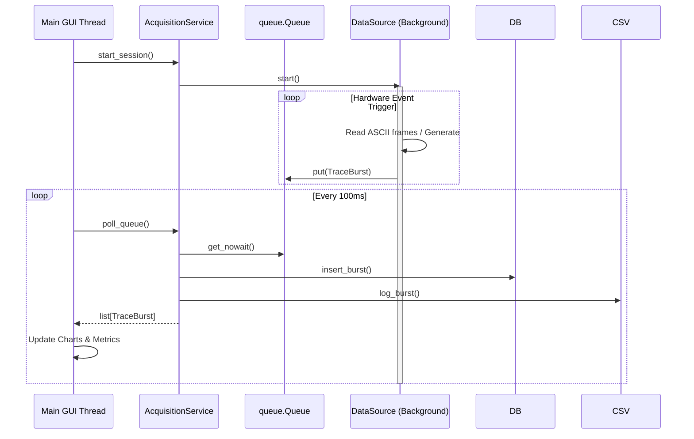

# BARC Telemetry Dashboard — System Specification & Architectural Documentation

This document serves as the comprehensive technical blueprint for the **BARC Telemetry Dashboard (v5.0.0 Burst Architecture)**. It details the system architecture, database schemas, concurrency models, operational protocols, and onboarding instructions.

---

## 1. System Overview & Executive Summary

The **BARC Telemetry Dashboard** is a high-performance desktop application built to acquire, visualize, analyze, and persist high-speed photodetector decay transients. It interfaces with an Arduino GIGA R1 which performs data acquisition at 250 kSPS. 

Instead of receiving a continuous low-frequency data stream, the dashboard receives discrete **Trace Bursts**. Each burst contains approximately 151 high-resolution data points captured over 600 microseconds, along with pre-computed metrics (e.g., peak voltage, fall time) evaluated on the hardware.

### Core Technology Stack
* **GUI Engine**: `CustomTkinter`. Provides a modern, dark-themed user interface without the heavy installation footprint or licensing complexities of Qt.
* **Visualization Engine**: `Matplotlib` via `FigureCanvasTkAgg`. Used to implement the dual-view trace and trend charts with native pan/zoom navigation toolbars.
* **Storage Engine**: `SQLite` (`telemetry.db`) using WAL mode and a persistent connection model. Trace arrays are serialized as JSON strings for ultra-fast, single-row inserts per burst event.
* **Concurrency Model**: A message-passing architecture using `queue.Queue`. Data sources run on background threads and produce `TraceBurst` objects. The main GUI thread uses a non-blocking timer (`root.after`) to poll the queue, route data to storage, and update the UI.

---

## 2. Software Architecture & Component Details

The codebase strictly decouples backend calculations (`core/`), data models (`models/`), and visual controls (`gui/`).

```
barc_dashboard/
├── main.py                     # Entry point orchestrator
├── config.py                   # Centralized configuration variables & settings loader
├── config_settings.json        # Saved user preferences
├── core/
│   ├── database/
│   │   └── manager.py          # Persistent SQLite connection & CRUD operations
│   ├── parser/
│   │   └── trace_parser.py     # Stateful ASCII framing parser
│   ├── services/
│   │   └── acquisition.py      # Decouples data sources from UI; routes bursts to DB & UI
│   ├── sources/
│   │   ├── base.py             # Abstract Base Class for data sources
│   │   ├── simulator.py        # Generates synthetic decay bursts
│   │   ├── serial_source.py    # USB CDC connection to hardware
│   │   └── ble_source.py       # Nordic UART Service Bluetooth connection
│   ├── logging/
│   │   └── csv_logger.py       # Auto-rotating daily CSV metrics logger
│   └── analysis/
│       └── signal.py           # Pure mathematical DSP calculation routines (Future Tabs)
├── models/
│   └── telemetry.py            # TraceBurst & TracePoint dataclasses
└── gui/
    ├── app.py                  # Main UI Controller coordinating components
    ├── components/
    │   ├── sidebar.py          # Left-aligned control panel frame
    │   └── chart.py            # Reusable styled Matplotlib canvas wrapper
    ├── dashboard/
    │   ├── page.py             # Main page frame (Grid definition)
    │   └── graph_renderer.py   # Updates matplotlib lines and numeric cards
    └── dialogs/
        ├── manager.py          # Session listing and loading table
        └── settings.py         # Config modification panel
```

---

## 3. Data Pipeline & Concurrency Model

### Message-Passing Queue Architecture
To keep the UI responsive, data acquisition operates in separate background threads, while SQLite insertion and GUI redrawing operate in the main thread via timer polling.



### The `TraceParser` State Machine
Because Bluetooth LE sends data in fragmented 20-byte chunks and Serial sends data in line-buffered chunks, the `TraceParser` abstracts out the protocol assembly. It buffers incoming string characters, searches for `---BEGIN TRACE DATA---` and `---END TRACE DATA---` markers, parses CSV lines into `TracePoint` objects, extracts variables following `---METRICS---`, and finally emits a clean `TraceBurst` object.

---

## 4. Storage Subsystem Design (SQLite & CSV)

### A. Database Entity Schema (SQLite)

#### Table: `sessions`
Stores metadata for recorded runs.
| Column | Type | Constraints | Description |
|---|---|---|---|
| `session_id` | TEXT | PRIMARY KEY | Unique ID (e.g. `RUN_20260716_100000`) |
| `name` | TEXT | NULLABLE | Friendly label tag assigned by user |
| `start_time` | TEXT | NOT NULL | Timestamp of creation |
| `source_type` | TEXT | | (simulator, serial, ble) |
| `burst_count` | INTEGER | DEFAULT 0 | Total number of bursts captured |

#### Table: `trace_bursts`
Stores full burst captures linked to sessions.
| Column | Type | Constraints | Description |
|---|---|---|---|
| `burst_id` | INTEGER | PRIMARY KEY AUTOINCREMENT | Unique record ID |
| `session_id` | TEXT | FOREIGN KEY | Parent session |
| `timestamp` | TEXT | NOT NULL | Timestamp of receipt |
| `peak_voltage` | REAL | | Parsed from hardware metrics |
| `fall_time_us` | REAL | | Parsed from hardware metrics |
| `trace_data` | TEXT | NOT NULL | Serialized JSON array of all points |

#### Database Performance Optimizations
1. **Persistent Connection Model**: To prevent `sqlite3.OperationalError: database is locked`, `DatabaseManager` maintains a single, thread-safe, persistent connection.
2. **JSON Serialization**: Instead of inserting 150 individual coordinate rows for a single 600us burst, the entire coordinate array is serialized into a JSON string and saved into the `trace_data` column in a single SQL operation.

### B. Daily Rolling CSV Logger
Saves a redundant, lightweight metrics trace. 
* **Naming Pattern**: `logs/telemetry_metrics_YYYYMMDD.csv`.
* **Headers**: `["Timestamp", "Burst_ID", "Peak_Voltage_V", "Fall_Time_us", "Avg_Fall_Time_us"]`

---

## 5. Firmware Integration Protocol

The dashboard interacts with the Arduino GIGA R1 via USB Serial or BLE Nordic UART Service.

**Commands sent to Hardware:**
- `START\n`: Command hardware to arm triggers.
- `STOP\n`: Command hardware to disarm.

**Payload received from Hardware:**
```text
---BEGIN TRACE DATA---
Sample_Index,Time_us,Voltage_V
0,0.0,2.4521
...
150,600.0,0.8234
---END TRACE DATA---
---METRICS---
peak_voltage=2.4521,fall_time_us=156.3,avg_fall_time_us=158.1
```

---

## 6. Failure Modes, Diagnostics, and Troubleshooting

### 1. `ModuleNotFoundError: No module named 'serial'` or `'bleak'`
* **Symptom**: The app crashes on startup.
* **Cause**: Missing hardware interface libraries in a fresh air-gapped environment.
* **Fix**: The architecture gracefully catches these errors in `core/sources/serial_source.py` and `ble_source.py`. The app will boot into Simulator mode. Install the wheel files to enable hardware.

### 2. SQLite Database Lock Errors
* **Symptom**: `sqlite3.OperationalError: database is locked`
* **Fix**: This was fixed in v5.0.0 by switching to a single persistent SQLite connection in `DatabaseManager`. Ensure external database explorer tools are closed during acquisition.

### 3. Linux/X11 Screen Scaling Issues
* **Symptom**: Text overlapping or giant buttons.
* **Fix**: Open `gui/app.py` and manually set `ctk.set_widget_scaling(1.0)` or `2.4` in the `__init__` constructor based on your display DPI, or adjust `ui_scale` in `config_settings.json`.
