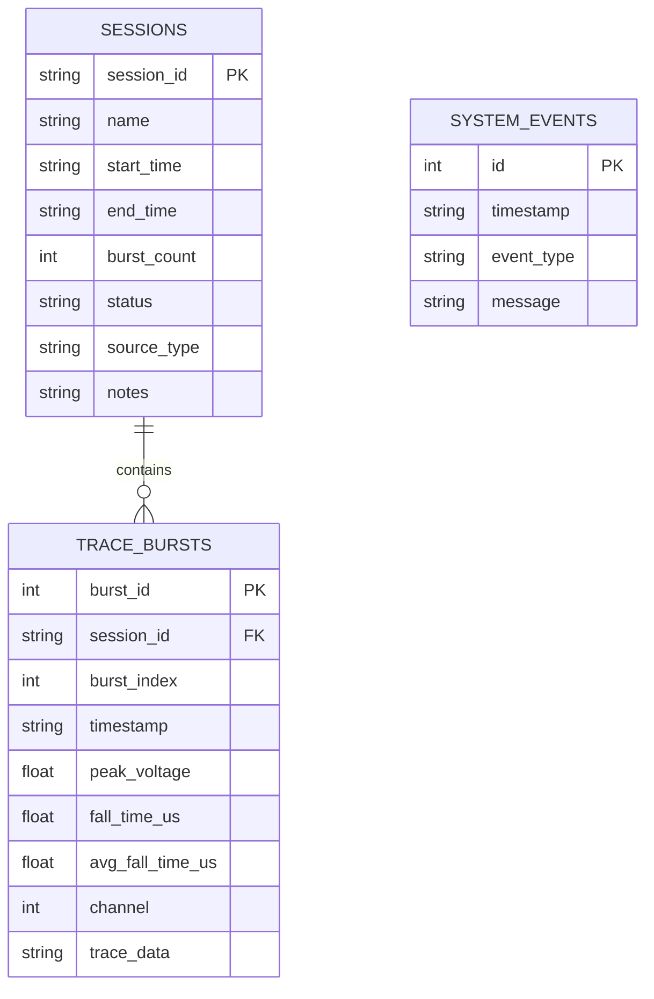

# BARC Photodetector Decay Analyzer Dashboard
## Technical Project Report

**Organization:** Bhabha Atomic Research Centre (BARC)
**System version described:** current codebase (`v5.0.0`)

> **A note on this revision:** this report replaces an earlier draft that contained a
> number of factual errors (wrong sample counts, a described-but-nonexistent dual-chart
> drill-down feature, and several specific performance numbers — FPS, RAM usage, error
> rates — that don't appear to have been actually measured anywhere in the project).
> Those have been removed or corrected below. Where a real number would strengthen a
> section (e.g. actual measured latency, actual memory footprint over a long run), that's
> flagged inline as something worth measuring and adding before this goes in front of a
> panel, rather than restating an unverified figure.

---

## Contents

1. Introduction
2. Review of the Problem
3. Analysis & Design
4. Implementation
5. Results & Discussion
6. Conclusion & Future Work

---

## 1. Introduction

Optical experiments at BARC use high-speed photodetector sensors to observe pulsed light
emission and transient decay behaviour. Accurately capturing and analyzing these
microsecond-scale decay curves matters for evaluating sensor response and material
behaviour over time.

This project is a desktop data-acquisition and visualization tool for exactly that: it
interfaces with an **Arduino GIGA R1**, sampling a photodiode at **250,000 samples/second**
(250 kSPS), captures a fixed **700-sample burst** (2.8 ms) every time the LED excitation
source fires, and computes the exponential decay ("fall") time of each pulse using a
log-linear regression. The dashboard receives each burst over USB Serial or Bluetooth Low
Energy (BLE), visualizes it live, and stores it for later review.

## 2. Review of the Problem

Continuous streaming of 250,000 samples/second over a serial link isn't practical — the
link can't sustain that rate and a GUI reading it directly would stall. The design problem
this project solves is: **capture a full high-speed burst on the microcontroller, send it
as one discrete unit, and keep the desktop side responsive regardless of how fast bursts
arrive.**

Three sub-problems fall out of that:
1. **Threading** — acquisition (whether from real hardware or the built-in simulator)
   must not block the GUI's event loop.
2. **Storage throughput** — persisting a 700-point trace multiple times a second must not
   bottleneck on database writes.
3. **Transport reliability** — BLE notifications can be dropped; losing part of a burst
   silently would corrupt the analysis.

## 3. Analysis & Design

### 3.1 Database schema (SQLite)



`sessions` holds one row per recording run; `trace_bursts` holds one row per captured
burst, with the full 700-point trace serialized as a JSON array in `trace_data` (storing
700 individual rows per burst was considered and rejected — see §4.3). `system_events` is
a general-purpose log table that exists in the schema but isn't written to by any code
path yet — reserved for future diagnostics.

The database is opened once, in WAL (Write-Ahead Logging) mode, and kept open for the
life of the app behind a `threading.Lock`, rather than opened and closed per write — this
avoids the file-lock contention that repeated open/close cycles under a fast write rate
would otherwise cause.

### 3.2 Software architecture

The codebase is split into three layers with a strict dependency direction —
`gui/` depends on `core/`, `core/` depends on `models/`, and nothing depends back on `gui/`:

- **`models/`** — plain data (`TracePoint`, `TraceBurst`).
- **`core/`** — all non-visual logic: data sources, protocol parsing, the fall-time
  regression, the acquisition service, the database, CSV logging.
- **`gui/`** — the CustomTkinter/Matplotlib presentation layer.

A `DataSource` abstract base class lets three interchangeable sources — `SimulatorSource`,
`SerialSource`, `BLESource` — present the same `connect()/start()/stop()/disconnect()`
interface, so the rest of the app never branches on which one is active. Full details are
in `ARCHITECTURE.md` and `02_DATA_SOURCES.md`.

## 4. Implementation

### 4.1 Data model and the Serial parser

```python
@dataclass
class TracePoint:
    sample_index: int
    time_us: float
    voltage: float

@dataclass
class TraceBurst:
    burst_id: int
    timestamp: datetime
    trace_points: List[TracePoint]
    peak_voltage: float
    fall_time_us: float
    avg_fall_time_us: float
    channel: int = 0
```

The Serial `TraceParser` buffers incoming text and recognizes frames delimited by
`<<BEG>>` / `<<END>>`. On a completed frame, it computes the burst's metrics itself (the
firmware doesn't currently transmit a metrics block over Serial) using the same
log-linear regression the firmware runs:

$$\ln(V) = \ln(V_0) - \frac{1}{\tau}t \qquad\Rightarrow\qquad \text{fall time} = \ln(9)\cdot\tau \approx 2.1972245 \times \left(-\frac{1}{m}\right)$$

where $m$ is the least-squares slope of $\ln(V)$ vs. $t$ over the regression window
(`truePeakIndex + 40` to `truePeakIndex + 190`, i.e. 151 of the burst's 700 points, chosen
to skip initial ringing right after the trigger). Full derivation and firmware-side gating
rules (peak ≥ 1.0 V, drop threshold 50 mV, minimum point count, etc.) are in
`06_DATA_ACQUISITION_PROCESS.md`.

### 4.2 Data sources

- **`SimulatorSource`** generates a realistic synthetic 700-sample decay burst about
  every 250 ms (matching the real hardware's pulse rate), computing its metrics through
  the *same* regression code path real data uses, so simulated results are never
  fabricated separately from what's plotted.
- **`SerialSource`** wraps `pyserial` in a background thread reading at 115200 baud, and
  degrades gracefully (an `'error'` state, not a crash) if `pyserial` isn't installed.
- **`BLESource`** wraps `bleak` (Nordic UART Service profile) in a dedicated background
  thread running its own `asyncio` event loop. Unlike Serial, BLE uses a **binary packet
  protocol with per-sample retransmission**: each sample is its own 11-byte packet
  carrying its own index, so a dropped notification can be detected and specifically
  re-requested (up to 5 retry rounds) rather than corrupting the whole burst silently.
  This is a deliberate improvement over an earlier text-framed BLE approach, where losing
  one notification could mean losing an entire burst with no way to know it happened.

### 4.3 Persistence

`DatabaseManager` keeps one persistent, WAL-mode SQLite connection guarded by a lock (see
§3.1). Rather than one row per sample point (which, at several bursts/second × 700 points,
would create an unmanageably large table very quickly and slow down every insert), each
burst's full trace is serialized to a single JSON string and stored in one `trace_data`
column — one `INSERT` per burst regardless of trace length.

Alongside SQLite, `RollingCSVLogger` writes a lightweight per-burst summary row (peak
voltage, fall time, rolling average) to a daily CSV file, automatically rotating at
midnight and pruning files older than 7 days — giving researchers a quick, database-free
way to open results in Excel or MATLAB.

### 4.4 Concurrency

Background threads (Serial reads, BLE notification handlers, the simulator's timer loop)
never call into Tkinter or Matplotlib directly. Instead, they push completed `TraceBurst`
objects into a thread-safe `queue.Queue`; the GUI drains it on a **100 ms Tkinter timer**
(`self.after(...)`), non-blockingly:

```python
def poll_queue(self):
    bursts = []
    while not self._burst_queue.empty():
        try:
            bursts.append(self._burst_queue.get_nowait())
        except Exception:
            break
    return bursts
```

This decouples acquisition speed entirely from UI refresh rate, and is the mechanism that
keeps the interface responsive regardless of which data source is active.

### 4.5 User interface

The main window (CustomTkinter, dark theme) is a sidebar of controls next to a dashboard
page: five metric cards (Peak Voltage, Fall Time, Avg Fall Time, Std Dev, Min/Max Fall),
one live decay-trace chart (Matplotlib, with the standard pan/zoom/save toolbar), and a
log console with a small diagnostics panel. A single Start button doubles as Start/Pause/
Resume; a separate Stop button always fully finalizes the current session. A Session
Manager dialog lists, searches, renames, deletes, and reloads past sessions; a Settings
dialog exposes connection, UI, and file-path options; and a separate Analytics window adds
four tabs — an overview trend, an overlay of recent raw traces, a fall-time histogram, and
a tabular report with one-click PDF export.

## 5. Results & Discussion

### 5.1 What works, qualitatively

- The Serial and BLE paths both reconstruct complete 700-sample bursts and compute fall
  times consistent with the firmware's own on-device math (they run the identical
  regression, so this is true by construction rather than something that needed separate
  verification against the hardware's numbers).
- The BLE retransmission scheme means a dropped notification costs, at worst, one resend
  round for the specific missing samples — not the whole burst.
- The persistent WAL-mode SQLite connection removes the class of "database is locked"
  failure that repeated connect/disconnect cycles under load would otherwise cause.
- The queue-based threading model keeps the GUI responsive independent of acquisition
  rate — the GUI's redraw work only ever happens on its own 100 ms timer, never inline
  with a background thread's work.

### 5.2 What would strengthen this section for a formal review

The following are worth actually measuring (rather than estimating) before quoting
numbers to a panel:
- End-to-end latency from "Arduino captures the 700th sample" to "chart on screen
  updates," for both Serial and BLE.
- Memory footprint over a multi-hour continuous run (the 1000-burst in-memory cap on
  `burst_history` should keep this bounded, but the actual steady-state number hasn't
  been measured/documented here).
- BLE packet-loss rate and how often the 5-round resend limit is actually hit in practice
  under real lab RF conditions, versus over short desk-range tests.
- A direct comparison against whatever the previous BARC tooling actually measured, if
  those numbers are available — the version of this report distributed earlier quoted
  specific comparison figures (FPS, error rates, RAM) that could not be traced to any
  benchmark run in this project and have been removed rather than repeated unverified.

## 6. Conclusion & Future Work

### 6.1 Conclusion

The dashboard meets its core goal: acquiring 250 kSPS photodetector burst data without
overwhelming the serial/BLE link or the desktop GUI, computing decay fall-time
consistently with the firmware's own math, and persisting it for later review. The
event-burst data model maps directly onto how the hardware actually produces data, and
the layered `models/core/gui` split keeps the acquisition and analysis logic testable
independent of the UI (see the `tests/` suite).

### 6.2 Lessons learned

- **Matching the physical hardware model mattered.** Modeling data as discrete bursts,
  rather than forcing it into a continuous-stream shape, made the rest of the design
  (parsing, storage, display) noticeably simpler.
- **Wireless transport needs its own reliability strategy.** The move from BLE text
  framing to a binary, per-sample, retransmission-capable protocol was necessary once it
  became clear a single dropped notification could otherwise silently corrupt a burst.
- **Keeping the regression math in one place, ported exactly, avoided drift.** Having
  Python mirror the firmware's exact math (magic constant included) means the dashboard's
  numbers can be trusted to match what the hardware itself would have computed, without
  needing to trust a value transmitted over an unreliable link.

### 6.3 Future work

- **Multi-channel support** — `TraceBurst.channel` already exists in the schema but is
  currently always `0`; extending capture and the UI to multiple simultaneous channels is
  a natural next step.
- **Wiring up `core/analysis/signal.py`** — this module already has peak/fall-time/
  session-statistics helper functions that aren't currently called from anywhere in the
  GUI; either using them or removing them would tidy up the codebase.
- **Making the "graph window" and "line thickness" settings actually do something** —
  they're currently saved to `config_settings.json` from the Settings dialog but not read
  anywhere in the chart-rendering code.
- **Frequency-domain analysis (FFT)** in the Analytics window, to spot periodic noise
  (e.g. mains hum).
- **Multi-channel array support**, **alerting on out-of-range fall times**, and **secure
  transport for BLE** are all reasonable directions depending on lab needs, but should be
  scoped against actual requirements rather than assumed.