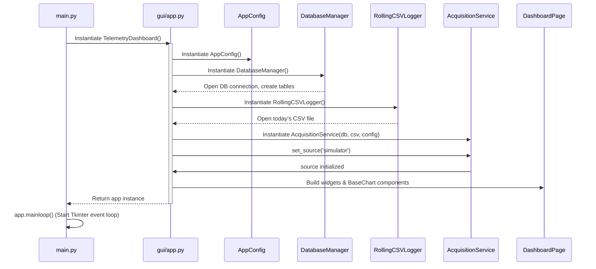
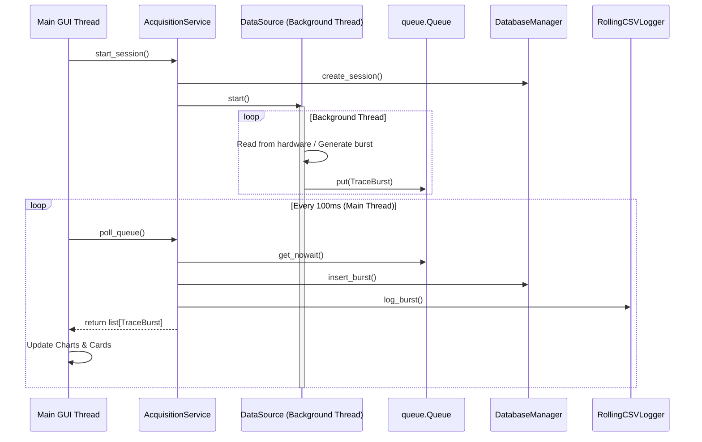

# BARC Dashboard — Execution & Data Workflow

This document explains the complete, step-by-step lifecycle of the application—from the moment you run `python main.py` to the moment you click close.

---

## Phase 1: Startup & Initialization

1. **Entry Point (`main.py`)**:
   * You run `python main.py`. 
   * `main()` instantiates the main application class `TelemetryDashboard()`.
2. **Backend Setup (`gui/app.py`)**:
   * Initializes `AppConfig` to load settings from JSON.
   * Initializes the **DatabaseManager** ([core/database/manager.py]), creating the connection and tables (`sessions`, `trace_bursts`, `system_events`).
   * Initializes the **RollingCSVLogger** for daily backups.
   * Initializes the **AcquisitionService** which orchestrates the data sources and connects to the default source (Simulator).
3. **UI Construction**:
   * **Sidebar** is built with controls and callbacks.
   * **DashboardPage** is built, embedding two `BaseChart` widgets (Decay Trace Chart and Trend Chart) and the metric cards.
4. **Daemon Setup**:
   * `app.py` starts a periodic Tkinter timer (`_start_polling()`) to poll the `AcquisitionService` queue every 100ms.

---

## Phase 2: Live Data Acquisition & Logging

When the user clicks the **Start Acquisition** button:

1. **Triggering the Stream**:
   * Clicking start calls `_on_start()` in `app.py`.
   * `AcquisitionService` creates a new session in SQLite and calls `start()` on the active `DataSource` (Simulator, Serial, or BLE).
   * For Serial/BLE, a `"START\n"` command is sent to the Arduino.
2. **Background Thread Loop (`DataSource`)**:
   * Hardware or Simulator produces data.
   * `TraceParser` translates text lines into `TraceBurst` objects.
   * `TraceBurst` objects are placed into a thread-safe `queue.Queue`.
3. **Polling & Storage (Main Thread)**:
   * The 100ms UI timer calls `AcquisitionService.poll_queue()`.
   * For each burst, it is inserted into the SQLite database and logged to the CSV file.
4. **GUI Callback**:
   * The dashboard graph renderer updates the decay trace chart with the new points and appends the metrics to the trend chart.

---

## Phase 3: Session Finalization & Playback

When the user clicks the **Stop** button or loads a historical session:

1. **Stop & Finalize**:
   * `app.py` calls `AcquisitionService.stop_session()`.
   * A `"STOP\n"` command is sent to the hardware.
   * The background thread halts. The session status is updated to 'completed' in SQLite.
2. **Session Loading**:
   * `DatabaseManager.get_session_bursts(session_id)` queries SQLite to retrieve all `TraceBurst` objects and their serialized JSON data.
3. **Replay Rendering**:
   * The `GraphRenderer` redraws the metric trend chart with all historical bursts, and sets the decay trace chart to the last burst of the session.

---

## Phase 4: Safe Application Exit

When the user clicks the close ('X') window button:

1. **Intercepting Exit**:
   * The window intercept protocol calls `on_close(app)` in `main.py`.
2. **Resource Cleanup (`app.cleanup()`)**:
   * **Acquisition Stop**: Signals the active `DataSource` to stop and disconnect.
   * **CSV Closing**: Closes the file handles for the rolling CSV logger.
   * **Database Close**: Closes the persistent SQLite connection cleanly, ensuring no database corruption.
3. **App Destroy**:
   * Calls `app.destroy()` to release all CustomTkinter frames and Matplotlib objects from RAM.
   * Calls `sys.exit(0)` to end the python process.
