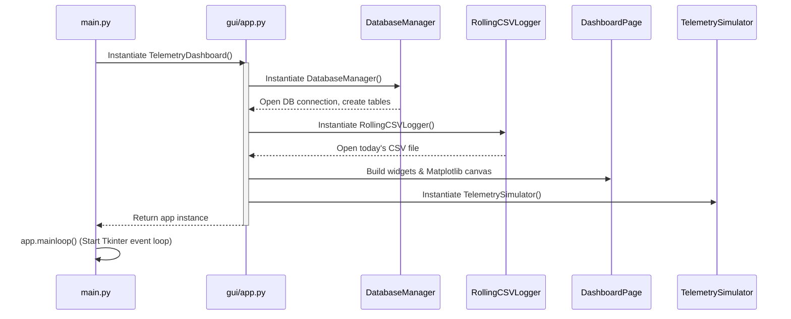
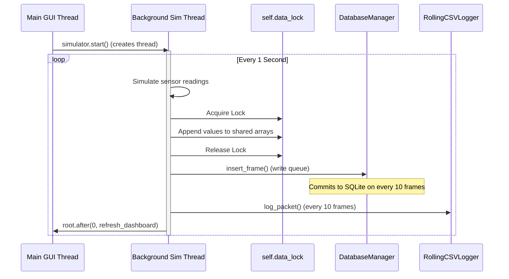

# BARC Dashboard — Execution & Data Workflow

This document explains the complete, step-by-step lifecycle of the application—from the moment you run `python main.py` to the moment you click close.

---

## Phase 1: Startup & Initialization



1. **Entry Point (`main.py`)**:
   * You run `python main.py`. 
   * `main()` instantiates the main application class `TelemetryDashboard()`.
2. **Backend Setup (`gui/app.py`)**:
   * The app initializes the **DatabaseManager** ([core/database/manager.py](file:///home/pranitchiman/Projects/barc_dashboard/core/database/manager.py)), which opens a persistent database connection and creates tables (`telemetry_sessions`, `pulse_telemetry`, `system_settings`, `system_events`) if they do not exist.
   * It initializes the **RollingCSVLogger** ([core/telemetry/csv_logger.py](file:///home/pranitchiman/Projects/barc_dashboard/core/telemetry/csv_logger.py)), opening or creating today's file (`telemetry_daily_YYYY-MM-DD.csv`).
   * It instantiates the `data_lock` thread mutex and empty shared lists (`time_data`, `channels_data`, `all_history`).
   * It queries SQLite for user settings (e.g., normalisation state, channel visibility, selected channel).
3. **UI Construction**:
   * **Sidebar** ([gui/components/sidebar.py](file:///home/pranitchiman/Projects/barc_dashboard/gui/components/sidebar.py)) is built with controls and callbacks.
   * **DashboardPage** ([gui/dashboard/page.py](file:///home/pranitchiman/Projects/barc_dashboard/gui/dashboard/page.py)) is built, embedding the Matplotlib canvas widget (`BaseChart`) and rendering blank lines for the channels.
4. **Daemon Setup**:
   * It creates the `TelemetrySimulator` instance and binds callbacks to the GUI main thread.
   * The application starts Tkinter's `app.mainloop()` event loop, resting idle until user interaction occurs.

---

## Phase 2: Live Data Simulation & Logging

When the user clicks the **Start Simulation** button:



1. **Triggering the Stream**:
   * Clicking start calls `_on_start()` in `app.py`.
   * It records metadata (session ID, time) in SQLite.
   * It starts the `TelemetrySimulator._run_loop()` in a separate background thread.
2. **Background Thread Loop**:
   * **Simulates ADC Readings**: Reads pseudo-random pulses (mimicking hardware sensor pulses).
   * **Thread Synchronization**: The thread locks access to data lists using `with self.data_lock:`, appends values, and immediately releases the lock.
   * **Database Insert**: Queues the reading into `DatabaseManager`. Every 10 frames, it flushes the queue in a single SQLite transaction write.
   * **CSV Backup**: Every 10 frames, it appends data rows to the rolling CSV file.
   * **UI Callback**: Calls `self.schedule(0, self.refresh)` which schedules the GUI redraw to run on the main thread via `root.after()`.

---

## Phase 3: GUI Redraw & Analytics Update

Scheduled by the simulation thread, the main thread runs the GUI update cycle:

1. **Acquiring Data Lock**:
   * `GraphRenderer.refresh()` runs on the GUI thread.
   * It locks `self.data_lock` to safely make local copies of `time_data` and `channels_data`. This ensures it doesn't read half-written data if the background thread fires at the exact same instant.
2. **Plot Redraw**:
   * Updates coordinates of the Matplotlib lines (`set_data()`).
   * Adjusts the X-axis limit: if live view is on, it auto-scrolls the graph to show the last $N$ seconds of data. If the user is panning/zooming, scrolling pauses.
   * Calls Matplotlib's `canvas.draw_idle()` to redraw the plot without blocking.
3. **Analytics Calculation**:
   * Calls signal processing routines in [core/analysis/signal.py](file:///home/pranitchiman/Projects/barc_dashboard/core/analysis/signal.py) for the selected channel (e.g. estimating frequency, peak-to-peak amplitude, rise time, and max jitter).
   * Updates the value labels on the top custom cards.

---

## Phase 4: Session Loading & Replay

When a user double-clicks a session in the Session Manager, or chooses a run in the sidebar dropdown:

1. **Stop & Reset**:
   * Any active simulation is stopped and database buffers are flushed.
   * Current graphical lines are cleared, and active memory data lists are emptied.
2. **Querying Database**:
   * `DatabaseManager.get_session_data()` queries SQLite:
     ```sql
     SELECT elapsed_seconds, ch1_voltage, ch2_voltage, ch3_voltage 
     FROM pulse_telemetry WHERE session_id = ? ORDER BY elapsed_seconds ASC;
     ```
3. **Populating & Drawing**:
   * The app acquires the thread lock and populates its memory lists with the records loaded from SQLite.
   * The `GraphRenderer` redraws the entire session timeline, and the analytics cards calculate and display metrics for that historical session.

---

## Phase 5: Safe Application Exit

When the user clicks the close ('X') window button:

1. **Intercepting Exit**:
   * The window intercept protocol `app.protocol("WM_DELETE_WINDOW", on_close)` calls `on_close(app)` in `main.py`.
2. **Resource Cleanup (`app.cleanup()`)**:
   * **Telemetry Stop**: Signals the background simulator thread loop to exit safely.
   * **Database Flush**: Flushes any final queued frames left in the database memory buffer to SQLite.
   * **CSV Closing**: Closes the file handles for the rolling CSV logger.
   * **Database Close**: Closes the persistent SQLite connection cleanly, ensuring no database corruption.
3. **App Destroy**:
   * Calls `app.destroy()` to release all CustomTkinter frames and Matplotlib objects from RAM.
   * Calls `sys.exit(0)` to end the python process.
